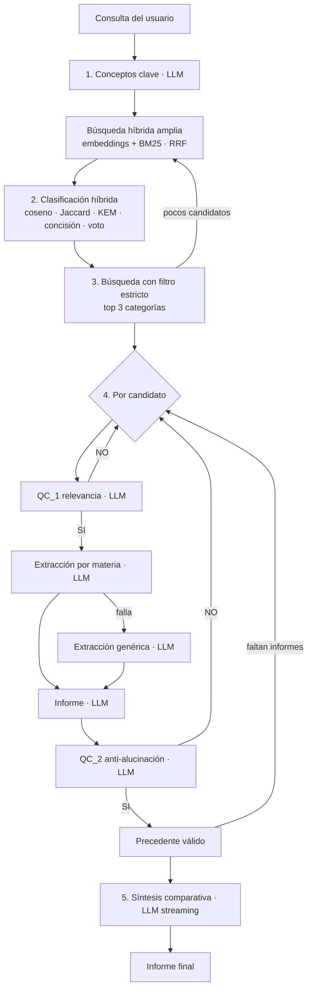

<div align="center">

# ⚖️ Co-piloto Jurídico Híbrido

**Análisis de precedentes judiciales del Supremo Tribunal de Justicia de Jalisco con RAG, LLMs locales y una interfaz web en Streamlit.**


</div>

---

## 📑 Tabla de contenidos

1. [Descripción](#-descripción)
2. [Características](#-características)
3. [Requisitos](#-requisitos)
4. [Instalación](#-instalación)
5. [Uso de la aplicación](#-uso-de-la-aplicación)
6. [Configuración](#%EF%B8%8F-configuración)
7. [Cambiar el modelo de lenguaje](#-cambiar-el-modelo-de-lenguaje)
8. [Arquitectura](#%EF%B8%8F-arquitectura)
9. [Datos](#-datos)
10. [Línea de comandos](#-línea-de-comandos)
11. [Evaluación](#-evaluación)
12. [Estructura del repositorio](#-estructura-del-repositorio)
13. [Desarrollo y pruebas](#-desarrollo-y-pruebas)
14. [Solución de problemas](#-solución-de-problemas)
15. [Limitaciones conocidas](#-limitaciones-conocidas)
16. [Hoja de ruta](#%EF%B8%8F-hoja-de-ruta)
17. [Contribuir](#-contribuir)
18. [Licencia](#-licencia)
19. [Autor y créditos](#-autor-y-créditos)
20. [Aviso legal](#%EF%B8%8F-aviso-legal)

---

## 📖 Descripción

El **Co-piloto Jurídico Híbrido** es un sistema de *Retrieval-Augmented Generation* (RAG) que, a partir de la
descripción de un caso, encuentra **sentencias similares** del Supremo Tribunal de Justicia del Estado de Jalisco
(STJ), verifica que sean pertinentes, extrae sus hechos clave, redacta un **informe profesional por precedente** y
cierra con una **síntesis comparativa** que responde a la consulta.

Todo se ejecuta **en local y de forma privada**: el LLM corre en [Ollama](https://ollama.com) (por defecto
`llama3.1:8b`) y la búsqueda usa una base vectorial ChromaDB local. Ningún dato de la consulta sale de tu equipo,
salvo que elijas conectar una API remota.

> 📘 **Introducción al proyecto:** antes de usar la app, revisa la presentación
> [**Análisis de sentencias judiciales** (PDF)](docs/An%C3%A1lisis%20de%20sentencias%20judiciales.pdf), que explica la
> motivación, la obtención de las sentencias mediante web scraping y el uso de IA generativa para resumirlas.
> El detalle académico completo (marco teórico, metodología, resultados) está en el
> [informe del proyecto (PDF)](docs/v8%20Co-piloto%20Jur%C3%ADdico%20H%C3%ADbrido%20-%20Informe.pdf) ·
> [versión Word](docs/v8%20Co-piloto%20Jur%C3%ADdico%20H%C3%ADbrido%20-%20Informe.docx).

Es "híbrido" en tres sentidos:

| Dimensión | Combinación |
|---|---|
| **Búsqueda** | Embeddings densos (semántica) + BM25 (léxica), fusionados con *Reciprocal Rank Fusion* |
| **Clasificación** | Similitud coseno + Jaccard + KEM + concisión + voto de recuperación, sin llamar al LLM |
| **Ejecución** | Modelo de embeddings para recuperar + LLM local para generar y verificar |

**El repositorio es autocontenido**: incluye el corpus balanceado (3,544 sentencias de 567 tipos) y su índice de
embeddings precalculado. La aplicación arranca lista para usarse, sin descargar ni procesar datos.

---

## ✨ Características

### Interfaz web
- 📝 **Consultas de ejemplo por tipo de caso**: 18 casos etiquetados por materia y delito/acción
  (*Penal · Robo calificado*, *Mercantil · Acción cambiaria directa*, *Familiar · Régimen de convivencias*…).
  Al elegir uno se carga en el editor y **se puede modificar** antes de analizar.
- 🎬 **Progreso animado paso a paso**: cada etapa muestra su estado (pendiente / en curso / completada / error),
  el tiempo que tardó y un detalle del resultado.
- 📜 **Logs en vivo** del pipeline, con el mismo nivel de detalle que el notebook original.
- ✍️ **Síntesis en streaming**: la respuesta final del LLM se escribe en pantalla mientras se genera.
- 📋 **Resultado profesional** en pestañas: *Síntesis*, *Precedentes* (ficha por sentencia con metadatos, informe,
  hechos extraídos y veredictos de calidad), *Clasificación* (tabla de puntajes) y *Logs*.
- ⬇️ **Exportación** del informe completo en Markdown.
- 📊 **Página de datos** con el balance del corpus y herramientas para ampliarlo, con logs en vivo.
- 🧠 **Selector de LLM** en la barra lateral: Ollama o cualquier API compatible con OpenAI.

### Pipeline RAG
- Extracción de conceptos clave con el LLM.
- Clasificación híbrida numérica en 567 categorías reales del corpus.
- Búsqueda adaptativa: filtro estricto por las 3 mejores categorías y ampliación semántica si faltan candidatos.
- **QC_1 (relevancia)**: descarta documentos de contexto distinto (p. ej. riña en un bar vs. violencia familiar).
- Extracción estructurada **por materia** (penal, civil, familiar, mercantil) con *fallback* genérico.
- **QC_2 (anti-alucinación)**: descarta informes que no corresponden a la consulta.
- Síntesis comparativa final de los precedentes válidos.

### Datos
- Corpus **balanceado**: máximo 30 sentencias por tipo, repartidas en el tiempo.
- Descargador balanceado que se detiene cuando todos los tipos alcanzan su meta y valida que cada PDF esté completo.
- Índice versionado en git (~90 MB, ningún archivo supera 25 MB) y ChromaDB reconstruida automáticamente.

---

## 💻 Requisitos

| Componente | Mínimo | Recomendado |
|---|---|---|
| Python | 3.10 | 3.12 |
| RAM | 8 GB | 16 GB o más |
| GPU | No es obligatoria | NVIDIA con ≥ 8 GB de VRAM (probado en RTX 4060 Laptop, 8 GB) |
| Disco | ~8 GB (dependencias + modelos) | — |
| LLM | [Ollama](https://ollama.com) con `llama3.1:8b` (4.9 GB) | — |
| Sistema | Linux, macOS o Windows | Linux |

> Sin GPU todo funciona, pero el modelo de embeddings y el LLM son notablemente más lentos.

---

## 📦 Instalación

### 1. Clonar el repositorio

```bash
git clone https://github.com/nachovazquez98/Co-piloto-Jur-dico-H-brido-con-local-LLM-y-RAG.git
cd Co-piloto-Jur-dico-H-brido-con-local-LLM-y-RAG
```

### 2. Crear el entorno e instalar dependencias

Con `pip`:

```bash
python -m venv .venv
source .venv/bin/activate            # Windows: .venv\Scripts\activate
pip install -r requirements.txt
pip install -e .
```

Con [`uv`](https://github.com/astral-sh/uv) (más rápido):

```bash
uv venv --python 3.12
source .venv/bin/activate
uv pip install -r requirements.txt -e .
```

> `requirements.txt` incluye el modelo de spaCy `es_core_news_sm`. Si `pip` instala una versión de PyTorch sin CUDA,
> instala la adecuada desde <https://pytorch.org/get-started/locally/>.

### 3. Instalar el LLM local

```bash
# Instala Ollama desde https://ollama.com y luego:
ollama pull llama3.1:8b
ollama serve                         # si no está corriendo como servicio
```

### 4. Ejecutar

```bash
streamlit run app/Copiloto.py
```

Abre <http://localhost:8501>. **En el primer arranque** la app:
1. Descarga el modelo de embeddings `intfloat/multilingual-e5-base` (~1 GB) desde Hugging Face.
2. Construye la base ChromaDB local en `data/chroma/` a partir del índice incluido (~1 minuto).

Los arranques siguientes tardan unos segundos.

---

## 🖥️ Uso de la aplicación

### Página **Copiloto**

1. **Elige una consulta de ejemplo** en el selector (o "Escribir mi propia consulta"). La etiqueta indica la materia y
   el tipo de delito o acción.
2. **Edita el texto** del caso: hechos, delito o acción y argumentos de las partes. Cuanto más concreto, mejor.
3. Ajusta en la barra lateral (opcional):
   - número de **precedentes** a analizar (1–5, por defecto 3);
   - activar o desactivar **QC_1** y **QC_2** (desactivarlos reduce el tiempo, pero también la precisión);
   - **modelo de lenguaje** y parámetros avanzados (temperatura, ventana de contexto, tokens de respuesta).
4. Pulsa **Analizar precedentes** y sigue el avance:

   | Paso | Qué ocurre |
   |---|---|
   | 1. Conceptos clave | El LLM extrae de 1 a 3 conceptos jurídicos de la consulta. |
   | 2. Clasificación híbrida | Se puntúan las categorías del corpus y se elige la más probable. |
   | 3. Búsqueda adaptativa | Embeddings + BM25 con filtro por las 3 mejores categorías; se amplía si hay pocos candidatos. |
   | 4. Análisis de precedentes | Por candidato: QC_1 → extracción → informe → QC_2, hasta reunir los informes pedidos. |
   | 5. Síntesis | El LLM compara los precedentes válidos y responde la consulta (en streaming). |

5. Revisa el resultado en las pestañas y descarga el informe en `.md`.

### Página **Datos**

- Métricas del corpus y distribución por materia.
- Tabla de tipos de sentencia con buscador y filtro por materia.
- Balance frente al catálogo oficial del STJ (tipos completos e incompletos, exportable a CSV).
- **Ampliar el corpus** (opcional): descarga balanceada, procesar PDFs locales y reindexar, con logs en vivo.

---

## ⚙️ Configuración

Los valores por defecto están en [`src/copiloto_juridico/config.py`](src/copiloto_juridico/config.py) y pueden
sobrescribirse con variables de entorno o con un archivo `.env` en la raíz (copia [`.env.example`](.env.example)).
Los parámetros del LLM también se cambian desde la barra lateral de la app.

| Variable | Por defecto | Descripción |
|---|---|---|
| `COPILOTO_LLM_PROVIDER` | `ollama` | `ollama` u `openai` (cualquier API compatible con OpenAI). |
| `COPILOTO_LLM_MODEL` | `llama3.1:8b` | Nombre del modelo. |
| `COPILOTO_LLM_BASE_URL` | `http://localhost:11434` | URL del servidor del LLM. |
| `COPILOTO_LLM_API_KEY` | *(vacío)* | API key para proveedores remotos. |
| `COPILOTO_LLM_TEMPERATURE` | `0.0` | Temperatura de generación. |
| `COPILOTO_LLM_MAX_TOKENS` | `1024` | Máximo de tokens por respuesta. |
| `COPILOTO_LLM_NUM_CTX` | `8192` | Ventana de contexto de Ollama. Determina cuánto texto de cada sentencia lee el LLM. |
| `COPILOTO_LLM_TIMEOUT` | `600` | Tiempo máximo por llamada (s). |
| `COPILOTO_NUM_PRECEDENTES` | `3` | Informes válidos que se buscan por consulta. |
| `COPILOTO_MAX_POR_TIPO` | `30` | Tope de sentencias por tipo al construir el corpus. |
| `COPILOTO_EMBEDDING_MODEL` | `intfloat/multilingual-e5-base` | Modelo de embeddings (si lo cambias, reindexa). |
| `COPILOTO_EMBEDDING_BATCH_SIZE` | `64` | Tamaño de lote al generar embeddings. |
| `COPILOTO_PDF_DIR` | `data/raw/pdfs` | Carpeta de PDFs para ampliar el corpus. |
| `COPILOTO_CHROMA_DIR` | `data/chroma` | Carpeta de la base ChromaDB local. |

Otros parámetros (pesos del clasificador, tamaño de fragmentos, número de candidatos) se ajustan directamente en
`config.py`.

---

## 🧠 Cambiar el modelo de lenguaje

En la barra lateral, sección **Modelo de lenguaje**:

| Proveedor | Úsalo para | URL de ejemplo |
|---|---|---|
| **Ollama (local)** | Cualquier modelo instalado con `ollama pull` (`llama3.1:8b`, `qwen2.5:7b`, `mistral`…). La lista se lee del servidor. | `http://localhost:11434` |
| **API compatible con OpenAI** | OpenAI, Groq, OpenRouter, Together, Mistral… | `https://api.openai.com/v1` |
| | Servidores locales: LM Studio, vLLM, llama.cpp server, text-generation-webui | `http://localhost:1234/v1` |

El indicador bajo el selector confirma si el servidor responde y si el modelo está disponible.

**Añadir un proveedor nuevo** (p. ej. una API con otro formato): crea una subclase de `LLMClient` en
[`llm.py`](src/copiloto_juridico/llm.py), implementa `stream()`, `list_models()` y `health()`, y regístrala en
`PROVIDERS`. Aparecerá automáticamente en la interfaz.

---

## 🏛️ Arquitectura

### Flujo de una consulta



### Fases del sistema

| Fase | Módulo | Descripción |
|---|---|---|
| **0. Descarga** | [`datos/descarga.py`](src/copiloto_juridico/datos/descarga.py) | Descarga balanceada desde la API pública del STJ: solo baja sentencias de tipos que no alcanzan su meta y termina cuando todos la alcanzan. Valida cada PDF (cabecera `%PDF`, marcador `%%EOF`, páginas legibles) y reintenta si llega incompleto. |
| **1. Procesamiento** | [`datos/procesamiento.py`](src/copiloto_juridico/datos/procesamiento.py) | Extrae el texto con `pypdf`. Los PDFs de más de 50 páginas se muestrean (10 iniciales + 15 finales + muestra del medio, 40 en total) porque no caben en el contexto. Limpia ruido con regex y aísla el cuerpo de la resolución. Los metadatos salen del nombre del archivo. Procesa en paralelo. |
| **Balance** | [`datos/balance.py`](src/copiloto_juridico/datos/balance.py) | Aplica el tope por tipo y reporta el avance frente al catálogo oficial. |
| **2. Indexación** | [`datos/indice.py`](src/copiloto_juridico/datos/indice.py) | Divide cada sentencia en fragmentos de 1,500 caracteres (200 de traslape, hasta 12 repartidos por documento) y genera embeddings normalizados con `multilingual-e5-base`. |
| **Base vectorial** | [`vectorstore.py`](src/copiloto_juridico/vectorstore.py) | Construye ChromaDB (espacio coseno) desde el índice y un BM25 a nivel de sentencia. La búsqueda agrupa fragmentos por sentencia y fusiona ambos rankings con RRF. |
| **3. Inferencia** | [`pipeline.py`](src/copiloto_juridico/pipeline.py), [`clasificador.py`](src/copiloto_juridico/clasificador.py) | Pipeline implementado como **generador de eventos** (`paso_inicio`, `log`, `precedente`, `token`, `resultado`…) que la interfaz consume para animar los pasos y mostrar los logs. |
| **Interfaz** | [`app/`](app) | Streamlit: página Copiloto y página Datos. |

### Clasificación híbrida

Para cada categoría candidata (top 20 por coseno más las que aparecen en los documentos recuperados):

```
score = 0.20·coseno_norm + 0.20·Jaccard + 0.20·KEM + 0.05·concisión + 0.35·voto_recuperación
score_final = score × penalización
```

- **Coseno normalizado**: similitud consulta–categoría reescalada al rango de los candidatos.
- **Jaccard**: solapamiento de lemas (spaCy) entre los conceptos clave y el nombre de la categoría.
- **KEM** (*Key Entity Match*): fracción de conceptos clave presentes en la categoría.
- **Concisión**: `1/√tokens`, favorece categorías generales.
- **Voto de recuperación**: suma del puntaje RRF de las sentencias de esa categoría entre las más relevantes.
- **Penalización**: ×0.90 a categorías largas con KEM bajo; ×0.70 a categorías con tokens irrelevantes.

### Prompts

Todos están en [`prompts.py`](src/copiloto_juridico/prompts.py): extracción de entidades, verificación de relevancia
(QC_1), extracción e informe por materia (penal, civil, familiar, mercantil y genérico), verificación posterior
(QC_2) y síntesis final. Los verificadores terminan en `VEREDICTO: SI|NO`, que se interpreta de forma estricta.

### Stack tecnológico

| Capa | Tecnología |
|---|---|
| Interfaz | Streamlit |
| LLM | Ollama (`llama3.1:8b`) o API compatible con OpenAI |
| Embeddings | `sentence-transformers` + `intfloat/multilingual-e5-base` (768 dim) |
| Base vectorial | ChromaDB (persistente, HNSW coseno) |
| Búsqueda léxica | BM25 propio sobre `scikit-learn` `CountVectorizer` |
| NLP | spaCy `es_core_news_sm` (lematización) |
| PDFs | `pypdf` |
| Datos | pandas, pyarrow (Parquet + zstd), NumPy |

---

## 📊 Datos

### Origen

Sentencias públicas del [Supremo Tribunal de Justicia del Estado de Jalisco](https://publicasentencias.stjjalisco.gob.mx),
descargadas de su API pública y procesadas con la Fase 1. El corpus se reconstruyó a partir del texto ya limpio de una
versión anterior del índice (5,805 sentencias) y de 44 PDFs locales (que ya estaban incluidos).

### Composición del corpus

| Materia | Sentencias | Tipos |
|---|---:|---:|
| Civil | 1,415 | 155 |
| Penal | 1,412 | 289 |
| Familiar | 485 | 85 |
| Mercantil | 228 | 36 |
| Laboral | 4 | 2 |
| **Total** | **3,544** | **567** |

Consulta el desglose completo por tipo en la página **Datos** de la app o con `python -m copiloto_juridico.cli estado`.

### Criterio de balance

- **Tipo** = materia + delito/acción, como lo publica el STJ (p. ej. `penal/robo-calificado`,
  `civil/accion-reivindicatoria`).
- **Meta por tipo** = `min(30, sentencias publicadas de ese tipo)`.
- Si hay más de 30, se eligen 30 **repartidas uniformemente por fecha**.
- El tope evita que los tipos frecuentes dominen la búsqueda y mantiene ligeros los archivos y los embeddings.

### Formato

| Archivo | Contenido |
|---|---|
| `data/corpus/sentencias-*.parquet` | `id`, `fecha`, `materia`, `delito_o_accion`, `tipo`, `texto`, `origen` |
| `data/indice/manifest.json` | Modelo, parámetros de fragmentación, huella del corpus, conteos |
| `data/indice/fragmentos.parquet` | `chunk_id`, `doc_id`, `chunk_idx` |
| `data/indice/embeddings-*.npy` | Matriz float16 (fragmentos × 768) |
| `data/catalogo/catalogo_tipos_stj.csv` | Catálogo oficial de tipos con el número de sentencias publicadas |

Más detalles en [`data/README.md`](data/README.md).

> ⚠️ **Descarga automática (oct-2026):** la API del STJ exige verificación reCAPTCHA. El descargador lo detecta y se
> detiene con un aviso; **no intenta evadirlo**. Para ampliar el corpus, copia PDFs nombrados
> `fecha_materia_delito.pdf` a `data/raw/pdfs/` y usa *Procesar PDFs*.

---

## 🧰 Línea de comandos

```bash
python -m copiloto_juridico.cli <comando>      # o el atajo instalado: copiloto-datos <comando>
```

| Comando | Descripción |
|---|---|
| `estado` | Sentencias por materia y avance del balance frente al catálogo. |
| `construir-corpus --pdfs DIR [--chroma DIR] [--max-por-tipo N] [--reiniciar]` | Une fuentes (corpus actual, ChromaDB antiguas, carpetas de PDFs), elimina duplicados, aplica el balance y guarda `data/corpus/`. |
| `indexar` | Genera los embeddings del corpus en `data/indice/` (unos 4 min en una RTX 4060). |
| `descargar [--destino DIR]` | Descarga balanceada desde la API del STJ. |

Flujo típico para ampliar el corpus:

```bash
python -m copiloto_juridico.cli construir-corpus --pdfs data/raw/pdfs
python -m copiloto_juridico.cli indexar
streamlit run app/Copiloto.py       # la base ChromaDB se reconstruye sola
```

---

## 📈 Evaluación

Prueba con las 18 consultas de ejemplo (`llama3.1:8b`, RTX 4060 Laptop 8 GB):

| Métrica | Resultado |
|---|---|
| Consultas cuyo filtro estricto incluye la categoría correcta | **15 / 18** |
| Consultas sin tipo dedicado en el corpus | 3 (amparo, cheque devuelto, contrato de suministro) |
| Tiempo por consulta con QC_1 y QC_2 activos (3 precedentes) | ~3–4 min |
| Primer arranque (construcción de ChromaDB) | ~1 min |
| Arranques posteriores | ~15 s |

Comparación de la búsqueda en la consulta de *robo calificado con violencia*:

| Versión | Tipos de las 3 primeras sentencias |
|---|---|
| Solo embeddings | violación, abuso sexual infantil, homicidio calificado |
| Híbrida (v10) | robo calificado y otro, robo calificado en grado de tentativa, robo calificado |

---

## 📁 Estructura del repositorio

```
.
├── app/                          # Interfaz Streamlit
│   ├── Copiloto.py               #   página principal (consulta, pasos animados, resultados)
│   ├── pages/1_Datos.py          #   corpus, balance y herramientas de datos
│   └── ui_common.py              #   recursos en caché, selector de LLM y estilos
├── src/copiloto_juridico/        # Paquete Python
│   ├── config.py                 #   configuración centralizada (.env)
│   ├── llm.py                    #   clientes de LLM (Ollama, API compatible con OpenAI)
│   ├── prompts.py                #   todos los prompts
│   ├── ejemplos.py               #   consultas de ejemplo etiquetadas
│   ├── embeddings.py             #   modelo de embeddings y fragmentación
│   ├── vectorstore.py            #   ChromaDB + BM25 + fusión RRF
│   ├── clasificador.py           #   clasificación híbrida
│   ├── pipeline.py               #   pipeline RAG como generador de eventos
│   ├── cli.py                    #   comandos de datos
│   └── datos/                    #   descarga, procesamiento, balance, corpus e índice
├── data/
│   ├── corpus/                   # texto de las sentencias (versionado)
│   ├── indice/                   # embeddings precalculados (versionados)
│   ├── catalogo/                 # catálogo oficial de tipos del STJ
│   └── README.md
├── notebooks/                    # notebook original v9.8 (referencia histórica)
├── docs/                         # presentación introductoria e informe académico (PDF/Word)
├── tests/                        # pruebas unitarias
├── .streamlit/config.toml        # tema de la interfaz
├── .env.example                  # plantilla de configuración
├── pyproject.toml · requirements.txt
├── CHANGELOG.md · CONTRIBUTING.md · LICENSE
└── README.md
```

---

## 🧪 Desarrollo y pruebas

```bash
pip install -e ".[dev]"
pytest                      # pruebas unitarias (no requieren GPU ni Ollama)
```

Las pruebas cubren el parseo de metadatos, el criterio de balance, el muestreo de páginas, la fragmentación, la
interpretación de veredictos de QC y el recorte de contexto.

**Tareas comunes**

| Quiero… | Dónde |
|---|---|
| Añadir o editar consultas de ejemplo | [`ejemplos.py`](src/copiloto_juridico/ejemplos.py) |
| Ajustar un prompt | [`prompts.py`](src/copiloto_juridico/prompts.py) |
| Cambiar pesos del clasificador o número de candidatos | [`config.py`](src/copiloto_juridico/config.py) |
| Añadir un proveedor de LLM | [`llm.py`](src/copiloto_juridico/llm.py) → `PROVIDERS` |
| Cambiar el modelo de embeddings | `COPILOTO_EMBEDDING_MODEL` y después `cli indexar` |

---

## 🩺 Solución de problemas

| Síntoma | Causa probable y solución |
|---|---|
| "Ollama no responde en http://localhost:11434" | Ollama no está corriendo: ejecuta `ollama serve`. |
| "El modelo 'llama3.1:8b' no está descargado" | `ollama pull llama3.1:8b`. |
| El primer arranque tarda varios minutos | Descarga del modelo de embeddings y construcción de ChromaDB; solo ocurre una vez. |
| Error de memoria en la GPU (CUDA OOM) | Baja la *ventana de contexto* en la barra lateral, usa un modelo más pequeño o cierra otras apps que usen la GPU. |
| Las consultas son muy lentas | Desactiva QC_1/QC_2, reduce el número de precedentes o usa un modelo más rápido. |
| `OSError: [E050] Can't find model 'es_core_news_sm'` | `pip install -r requirements.txt` (incluye el modelo) o `python -m spacy download es_core_news_sm`. |
| La descarga se detiene con "exige verificación reCAPTCHA" | Limitación de la API del STJ; usa PDFs locales (ver [Datos](#-datos)). |
| Quiero reconstruir la base vectorial | Borra `data/chroma/` y reinicia la app. |

---

## 🚧 Limitaciones conocidas

- **Cobertura desigual**: 567 tipos en el corpus, pero muchos tipos del catálogo oficial tienen pocas o ninguna
  sentencia. Mientras la API exija reCAPTCHA no es posible completarlos automáticamente.
- **Sin tipos de amparo, adolescentes, cheques ni contratos de suministro**: las consultas sobre esos temas reciben
  precedentes cercanos, no del mismo tipo.
- **Etiquetas basadas en el nombre del archivo**: si el STJ etiqueta mal una sentencia, la categoría es incorrecta
  (QC_1 mitiga el impacto).
- **Muestreo de PDFs largos**: en sentencias de más de 50 páginas solo se leen 40.
- **Texto anonimizado**: los datos personales vienen testados (`[ELIMINADO]`); los informes los marcan como no disponibles.
- **Tiempo**: con un LLM de 8B en local, cada consulta tarda varios minutos.
- **Sin OCR**: los PDFs escaneados como imagen no aportan texto.

---

## 🗺️ Hoja de ruta

- [ ] Completar el balance del catálogo cuando la descarga lo permita (o por solicitud de transparencia al STJ).
- [ ] OCR (Tesseract / PyMuPDF) para PDFs escaneados.
- [ ] Clasificación de materia y tipo con el LLM a partir del contenido, no del nombre del archivo.
- [ ] Ajustar los pesos del clasificador con un conjunto etiquetado.
- [ ] Re-ranking con *cross-encoder*.
- [ ] Exportación del informe a PDF/Word.
- [ ] Imagen Docker con Ollama incluido.

---

## 🤝 Contribuir

¡Las contribuciones son bienvenidas! Lee [`CONTRIBUTING.md`](CONTRIBUTING.md) para preparar el entorno, el estilo de
código y el flujo de *pull requests*. Para errores o propuestas, abre un
[issue](https://github.com/nachovazquez98/Co-piloto-Jur-dico-H-brido-con-local-LLM-y-RAG/issues).

El historial de versiones está en [`CHANGELOG.md`](CHANGELOG.md).

---

## 📄 Licencia

El código se distribuye bajo la licencia **MIT**; consulta [`LICENSE`](LICENSE). Las sentencias incluidas en `data/`
son documentos públicos del Supremo Tribunal de Justicia del Estado de Jalisco y conservan su propio régimen.

---

## 👤 Autor y créditos

- **Ignacio Vázquez** — desarrollo del proyecto ([@nachovazquez98](https://github.com/nachovazquez98)).
- Sentencias: [Supremo Tribunal de Justicia del Estado de Jalisco](https://www.stjjalisco.gob.mx), portal de
  sentencias públicas.
- Modelos: [Meta Llama 3.1](https://ollama.com/library/llama3.1), [multilingual-e5-base](https://huggingface.co/intfloat/multilingual-e5-base),
  [spaCy](https://spacy.io).

La presentación introductoria y el informe académico del proyecto están en [`docs/`](docs).

---

## ⚖️ Aviso legal

Herramienta académica de apoyo basada en sentencias públicas. **No constituye asesoría jurídica** ni sustituye a un
profesional del derecho. Los informes los genera un modelo de lenguaje y pueden contener errores u omisiones;
verifica siempre la sentencia original antes de tomar cualquier decisión.
